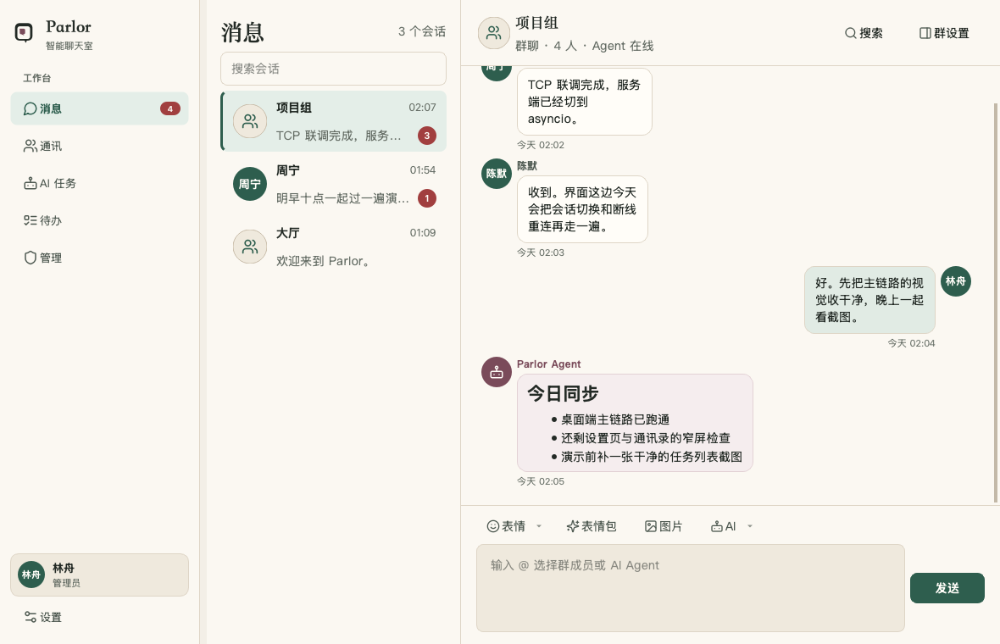
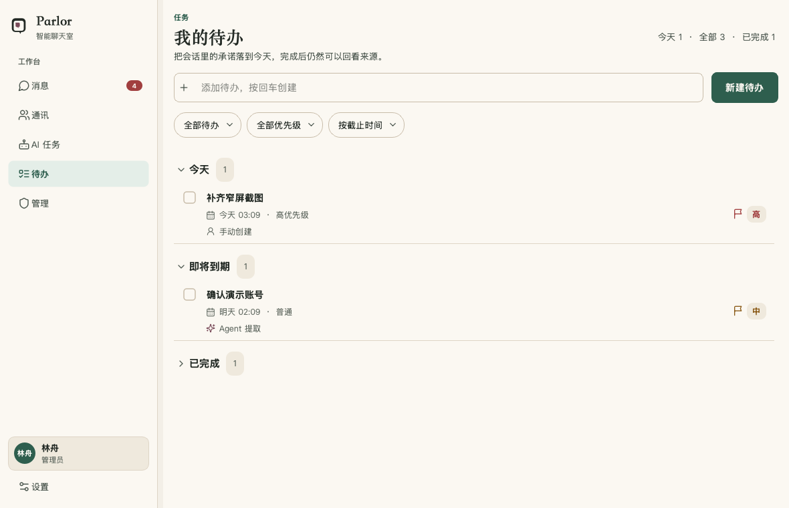
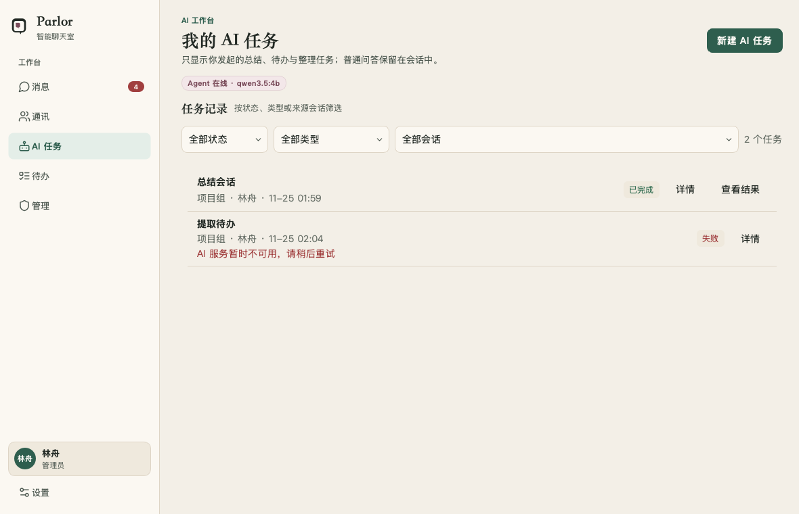

<p align="center">
  <picture>
    <source media="(prefers-color-scheme: dark)" srcset="docs/brand/kit/ai-agent-horizontal-reversed.svg">
    
  </picture>
</p>

# Parlor 智能聊天室

Parlor 是一个支持多人实时交流和 AI 协作的桌面聊天室。PySide6 客户端通过 TCP 连接 Python `asyncio` 服务端；服务端负责身份认证、消息路由、群组权限、SQLite 持久化，以及 Agent 的模型调用和工具执行。模型服务不可用时，普通聊天仍可使用。

**阅读路径：** [功能与边界](#功能概览) · [快速开始](#快速开始) · [系统设计](#系统设计) · [通信与存储](#通信协议与数据存储) · [Agent 工具](#agent-任务与工具) · [验证与截图](#运行结果与验证) · [常见问题](#常见问题)

## 功能概览

| 领域 | 已实现能力 |
| --- | --- |
| 实时通信 | 多客户端在线、注册登录、在线状态、一对一私聊、公开群聊、异常断线清理与重连同步 |
| 消息 | 文本、Emoji、图片、表情包、引用回复、编辑、已读与输入状态、历史检索、撤回 |
| 群组 | 创建与加入群组、成员管理、群内昵称、禁言、群级 Agent 工具权限 |
| Agent | 会话问答、群聊总结、结构化待办提取、定时总结、角色卡、长期记忆、工具调用审计 |
| 个人待办 | 创建、编辑、完成、恢复、筛选和排序；从聊天提取结果导入，按账户隔离并实时同步 |
| 管理 | 独立 Web 管理台，管理用户、群组、模型配置、联网搜索、表情包与审计记录 |

一个典型流程是三位用户同时登录、发送私聊与群消息，其中一位关闭客户端；其他人继续发送消息，重连后该用户收到离线期间的内容。随后在群内发送 `@Agent 总结最近 20 条消息`，Agent 在服务端读取**当前授权会话**的记录、生成摘要并回复同一群聊；调用过程可在工具审计中查看。

### 房间与会话模型

客户端通过一条 TCP 连接使用多个逻辑会话，切换会话不需要重新连接。服务端用消息中的 `conversation_type` 和 `conversation_id` 标识消息属于哪个会话：

| 会话 | 标识与存储 | 谁能查看与接收消息 |
| --- | --- | --- |
| 默认“大厅” | 服务端初始化时创建的群；新账号注册后自动加入，不能退出 | 大厅成员 |
| 其他公开群 | 在 `groups` 表中有独立群 ID；创建者成为群主，加入关系保存在 `group_members` | 当前群成员 |
| 双人私聊 | 两个用户 ID 排序生成固定 ID，例如 `dm:12:35`；不在 `groups` 表中建群，`private_conversations` 只记录会话列表状态 | 这两个用户 |

群聊和私聊消息统一保存在 `messages` 表，通过会话类型与 ID 隔离历史；`read_cursors` 按用户和会话记录阅读位置。服务端在发送、读取历史和转发事件时检查群成员资格或私聊参与者身份。群消息只投递给该群成员，私聊消息只投递给双方。

Agent 不占用独立房间。在群聊中，只有已加入且启用的 Agent 能被提及触发；也可以在双人私聊中显式调用 Agent。它读取发起人有权访问的**当前会话**，把结果写回同一会话。因此私聊中的 Agent 回复对私聊双方可见；群级工具设置还能进一步收紧群内授权。服务端每次执行前重新校验权限，界面按钮是否可见不参与授权。

## 快速开始

### 环境准备

- Python 3.10 或更新版本；建议使用虚拟环境。
- 服务端仅使用 Python 标准库；桌面客户端需要 `PySide6>=6.7,<7`（见 [requirements.txt](requirements.txt)）。SQLite 随 Python 提供。
- Agent 可以连接本机 Ollama，也可以在管理台配置受支持的模型服务；不配置模型也可以使用基本聊天。

在项目根目录执行：

```bash
python -m venv .venv
source .venv/bin/activate
python -m pip install -r requirements.txt
cp .env.example .env
```

Windows PowerShell 将激活命令换成 `.\.venv\Scripts\Activate.ps1`，复制配置用 `Copy-Item .env.example .env`。首次启动前编辑 `.env`，尤其要修改示例中的 `CHAT_ADMIN_PASSWORD`。在 macOS/Linux 上，服务端要求 `.env` 仅当前用户可读写：

```bash
chmod 600 .env
```

`.env` 由服务端和客户端入口直接读取，无需安装 `python-dotenv`。常用配置如下；其余选项及示例值见 [.env.example](.env.example)。

| 配置 | 示例默认值 | 用途 |
| --- | --- | --- |
| `CHAT_HOST` / `CHAT_PORT` | `127.0.0.1` / `8765` | TCP 服务端监听地址 |
| `CLIENT_HOST` / `CLIENT_PORT` | `127.0.0.1` / `8765` | 桌面客户端连接地址 |
| `CHAT_DATA_DIR` | `./data` | 数据库、媒体和管理配置目录 |
| `CHAT_ADMIN_USERNAME` / `CHAT_ADMIN_PASSWORD` | `admin` / 示例占位密码 | 首次初始化管理员；密码必须修改 |
| `AGENT_ENABLED` / `AGENT_MODEL` | `true` / `chatroom-qwen3.5-4b` | Agent 开关与初始模型 |
| `AGENT_BASE_URL` / `AGENT_CLOUD_FALLBACK` | 本机 Ollama / `false` | 模型地址与云端降级开关 |
| `ADMIN_HOST` / `ADMIN_PORT` | `127.0.0.1` / `8766` | 独立管理台监听地址 |

### 启动服务端与客户端

先在一个终端启动服务端：

```bash
python -m server
```

启动成功时，服务端日志会出现“聊天室服务已启动”和监听地址；启用管理台时，还会出现“管理面板已启动”。即使模型健康检查失败，仍可继续使用注册、登录和聊天功能。

再分别打开客户端终端，运行：

```bash
python -m client
```

默认聊天地址为 `127.0.0.1:8765`，管理台地址为 [http://127.0.0.1:8766](http://127.0.0.1:8766)。客户端首次使用先注册，再登录；可以启动三个客户端并注册 `alice`、`bob`、`carol` 等不同账号。服务端启动时初始化数据库和默认“大厅”。

客户端可通过 `python -m client --host <服务端地址> --port 8765` 指向其他主机。局域网使用时，服务端在 `.env` 中设置 `CHAT_HOST=0.0.0.0`，客户端设置 `CLIENT_HOST=<服务端局域网 IP>`，并仅在可信网络开放聊天端口。管理台默认只监听本机。

### 启用本地 Agent

先安装并启动 [Ollama](https://ollama.com/)，再在项目根目录准备默认模型：

```bash
ollama pull qwen3.5:4b
ollama create chatroom-qwen3.5-4b -f ollama/Modelfile
ollama list
```

示例配置中的 `AGENT_BASE_URL` 为 `http://127.0.0.1:11434`，`AGENT_MODEL` 为 `chatroom-qwen3.5-4b`。其他模型可在本机管理台测试并切换；联网搜索需要另行配置搜索服务并授予 Agent 工具权限。模型请求由服务端发起，客户端不直接连接 Ollama。

`.env` 提供首次启动的模型设置；管理台保存的模型配置会持久化，后续切换应在管理台操作。若只想体验聊天，可先跳过模型准备。

## 系统设计

```text
PySide6 客户端 ── TCP 长度前缀 JSON ──▶ asyncio 服务端 ──▶ SQLite / uploads
       ▲                                 │
       └──────── 状态事件与消息 ◀─────────┤
                                         └── HTTP ──▶ Ollama / 其他模型服务
```

客户端的数据流是 `NetworkClient -> ChatService -> AppStore -> UI`：网络线程处理收发与重连，Service 封装协议命令，Store 将事件整理成页面状态，Qt Widgets 页面展示状态并发起操作。服务端按协议类型分发请求，执行身份和会话权限校验后，路由私聊或广播群消息。数据库使用 SQLite WAL 保存用户、群组、消息、同步游标、待办和审计信息；媒体经校验后保存在 `data/uploads/`。

### 模块分工

```text
shared/protocol.py       TCP 帧与公共消息信封
client/network.py        后台 Socket 收发、自动重连
client/service.py        客户端协议命令
client/store.py          会话、消息与待办状态投影
client/v2/               Qt Widgets 页面、组件、主题与窗口
server/app.py            asyncio 连接、路由与广播
server/handlers/         认证、群组、消息、待办、Agent 请求
server/storage/          SQLite 表结构与数据访问
server/agent_runtime/    上下文、模型生成与工具执行
server/admin/            独立本机 Web 管理台
```

一次聊天请求沿“客户端命令 → TCP 帧 → 服务端分发与权限校验 → SQLite 写入 → 目标会话事件广播 → Store 更新 → UI 渲染”流转。数据库操作交给后台线程，模型调用受并发数与超时限制，避免阻塞普通消息处理。

## 通信协议与数据存储

TCP 是字节流，单次读取不保证恰好得到一条消息。为处理拆包与粘包，协议使用 **4 字节无符号大端长度 + UTF-8 JSON**；接收端先读取长度，再读完整消息体，客户端增量解码器可以一次处理多个连续帧。单帧上限为 4 MiB。公共消息信封包含 `version`、`request_id`、`type`、`timestamp` 和 `payload`；最终消息 ID 与时间由服务端生成。

例如，发送消息的信封形状如下，具体 `payload` 由客户端 Service 按会话填充：

```json
{
  "version": 1,
  "request_id": "550e8400-e29b-41d4-a716-446655440000",
  "type": "message.send",
  "timestamp": 0,
  "payload": {
    "conversation_type": "group",
    "conversation_id": "1",
    "content": "大家好",
    "message_type": "text"
  }
}
```

`request_id` 用于关联回执，并帮助服务端识别重复发送；`history.sync` 使用消息游标补取历史，`history.search` 只检索当前用户可访问的会话。图片以 Base64 放入协议帧，原始文件不得超过 2 MiB；服务端检查 MIME、文件签名和大小后生成随机文件名。支持 PNG、JPEG、GIF 和 WebP。客户端通过已授权的消息取回媒体。

| 数据 | 存放位置 | 关键约束 |
| --- | --- | --- |
| 用户与群成员 | SQLite `users`、`groups`、`group_members` | 密码以随机盐和 PBKDF2 摘要保存；群成员关系决定访问权限 |
| 消息与同步 | `messages`、`message_events`、`read_cursors` | 会话范围和消息 ID 建索引；断线后按游标同步 |
| 个人待办 | `personal_todos`、`todo_revisions` | 按所有者隔离，更新使用版本校验 |
| Agent 与审计 | `agents`、`agent_runs`、`tool_calls` 等 | 保存运行状态、工具调用结果和授权会话 |
| 图片与管理配置 | `data/uploads/`、`data/admin/` | 文件与数据库一起备份；配置包含密钥，不进入版本库 |

服务端使用 SQLite WAL。备份时先停止服务端，再同时复制数据库与上传目录；运行中只复制数据库主文件可能遗漏尚在 WAL 中的写入。

## Agent 任务与工具

Agent 作为服务端能力运行。用户触发后，服务端先检查当前会话的访问权、Agent 是否启用及工具权限，再读取允许范围内的消息并调用模型。`read_conversation_messages`、`search_conversation_messages`、`save_agent_result` 等工具是真正执行的服务端函数；调用状态、耗时和授权范围会写入审计记录。模型可使用原生 Tool Calling，不支持时使用结构化工具桥；两条路径共用校验与授权。个人待办工具的所有者由服务端绑定到请求用户，更新和删除还要通过版本检查。模型失败或超时时，Agent 返回明确失败状态，不阻断 TCP 聊天。

| 工具示例 | 实际动作 | 使用边界 |
| --- | --- | --- |
| `read_conversation_messages`、`search_conversation_messages` | 从 SQLite 读取或检索历史 | 限于本次授权会话，排除无权访问的消息 |
| `save_agent_result` | 将结果写回原会话 | 结果由服务端保存并广播 |
| `list_todos`、`create_todo`、`complete_todo` | 查询或变更个人待办 | 所有者绑定当前请求用户；写入需工具授权 |
| `web_search` | 查询公开网页并附来源 | 需配置搜索服务及工具权限；搜索词来自本次请求 |

Agent 的全局工具授权由所有者或管理员管理，群主可在群内进一步禁用工具，不能放宽全局授权。工具调用记录由服务端真实执行时产生，包含工具名、状态、授权会话及耗时；它不是根据模型回复文字推测出来的。长期记忆默认关闭，启用后仍按用户或群组范围隔离。

## 开发导航

更细的模块边界见[系统结构图](docs/architecture/project-map.md)，界面规范见[设计系统](docs/ui/design-system.md)。扩展现有功能时，先看[协议帧与信封](shared/protocol.py)、[事件分发](server/app.py)及对应的[服务端处理器](server/handlers/)；客户端命令经 [ChatService](client/service.py) 发出，服务端事件由 [AppStore](client/store.py) 投影后通知页面。新增 Agent 工具需同步检查[工具声明](server/tools.py)、[运行时执行与授权](server/agent_runtime/)及审计记录；新增页面视觉值沿用 V2 语义 token。

## 操作示例

1. 启动三个客户端并登录不同账号。在在线用户列表选择另一位用户发送私聊，再进入“大厅”或新建公开群发送群消息。
2. 在群内发送图片或 Emoji，搜索刚发送的关键词；群主可管理成员和禁言，用户可在允许的时间内撤回自己的消息。
3. 关闭一个客户端，继续向该用户发消息；重新启动并登录，检查在线状态与未读消息同步。
4. 在群内输入 `@Agent 总结最近 20 条消息` 或 `@Agent 提取最近 50 条消息中的待办`。查看回复、结构化待办卡片和 AI 任务中心的工具记录。
5. 将提取出的待办加入个人待办，设置优先级或截止时间，完成后再恢复；多客户端重新登录后检查状态。

这些操作的可观察结果包括：三端在线列表更新；私聊只出现在参与者界面；群消息同步显示在该群成员界面；断线用户重连后补齐消息；Agent 的回复进入原会话，AI 任务中心可查看实际工具记录。普通历史搜索只检索有权访问的聊天记录。

### 扩展功能

| 功能 | 使用效果 | 主要实现 |
| --- | --- | --- |
| 历史持久化与检索 | 重启后仍可按会话查看和搜索消息 | `server/storage/messages.py`、`server/handlers/messages.py` |
| 图片与表情包 | 发送图片、使用用户或管理台维护的表情包 | `server/media.py`、`server/stickers.py` |
| 离线同步 | 异常断线后自动重连，按游标补取消息 | `client/network.py`、`client/store.py`、`read_cursors` 表 |
| 群组管理 | 禁言、撤回及服务端越权拒绝 | `server/handlers/groups.py`、`server/handlers/messages.py` |
| 个人待办与定时总结 | 待办跨客户端同步；群聊有新消息时可定时总结 | `server/todos.py`、`server/agent.py` |
| 可选联网搜索 | Agent 查询公开网页并在回复中附来源 | `server/search_provider.py`、`server/agent_runtime/` |

联网搜索需要在管理台配置搜索服务，并为 Agent 授权 `web_search`；群内还可以收紧该工具权限。未配置或失败时，Agent 应说明无法实时核查。

## 运行结果与验证

下面的截图由真实界面组件加载固定的内存示例数据生成，用于展示布局和状态；它们不是联网实测或 Agent 成功调用的证明。

| 聊天界面 | 个人待办 | AI 任务 |
| --- | --- | --- |
|  |  |  |

完整的浅色、深色及不同窗口尺寸截图见[截图目录](docs/ui/screenshots/README.md)。要复现主要行为，可按上面的操作示例观察三客户端在线、私聊与群广播、异常退出后的离线同步，以及 Agent 的“读取会话 → 生成结果 → 回复原会话 → 留下工具记录”链路。

[查看管理台截图](docs/ui/screenshots/baseline-2026-11/admin-web-light-1440x1000.png)。截图和自动化用例各自证明不同的内容：前者展示界面布局，后者检查协议、权限和状态行为。

自动化测试从项目根目录运行：

```bash
python -m unittest discover -s tests -p 'test_*.py' -v
python -m compileall -q client server shared
```

`tests/test_protocol.py` 覆盖粘包、拆包及非法帧；`tests/test_server_integration.py` 覆盖认证、多人聊天、权限和重连；`tests/test_agent.py` 与 `tests/test_personal_todos.py` 覆盖 Agent 工具和待办；`tests/test_v2_ui.py` 覆盖桌面交互。真实 Ollama 联调测试默认跳过；在已准备好本地模型的机器上，可用 `RUN_OLLAMA_LIVE=1 python -m unittest tests.test_ollama_live -v` 单独执行。其结果应与普通自动化测试分开记录。

本次文档校对使用 Python 3.13.12、PySide6 6.12.0 和 Qt offscreen：上述协议、服务端、Agent、待办与 UI 目标测试 87 项通过；完整测试运行 244 项，结果为 `OK (skipped=1)`，跳过的是需要真实 Ollama 的联调用例；`compileall` 通过。自动化结果验证了代码行为，实际桌面效果仍应在目标设备上检查。

## 常见问题

| 现象 | 检查方式 |
| --- | --- |
| 服务端提示 `.env` 权限过宽 | macOS/Linux 在项目根目录执行 `chmod 600 .env`；确认文件属于当前用户 |
| 客户端无法连接 | 先确认服务端已启动，再核对 `CLIENT_HOST` / `CLIENT_PORT` 与 `CHAT_HOST` / `CHAT_PORT`；跨机器时检查局域网地址与防火墙 |
| 管理台打不开 | 检查 `ADMIN_ENABLED`、`ADMIN_HOST` 和 `ADMIN_PORT`；默认只能从服务端本机访问 `127.0.0.1:8766` |
| Agent 离线或调用失败 | 运行 `ollama list`，核对模型 ID 与管理台配置；普通聊天可继续使用 |
| 图片发送失败 | 检查是否为 PNG、JPEG、GIF 或 WebP，原始文件不超过 2 MiB，文件内容与格式声明一致 |
| 重启后数据不符 | 检查 `CHAT_DATA_DIR` 是否指向预期目录；恢复备份时数据库与 `uploads/` 应来自同一时点 |

## 设计取舍与复盘

- 使用长度前缀帧和统一 JSON 信封，让消息边界与请求关联可预测；服务端生成最终 ID，避免依赖客户端时钟。
- 将权限判断、Agent 工具和数据写入放在服务端，客户端只负责操作和展示。模型不能扩大用户对会话或个人待办的访问范围。
- 让模型服务成为可降级依赖；普通通信、历史记录和群组管理不依赖模型运行。
- 以 SQLite WAL 和同步游标支持消息持久化及重连恢复，但部署时需要一起考虑数据库与上传文件的备份时点。

## 已知限制

- 真实 Ollama 联调测试默认跳过；需要在安装模型并允许本地服务访问的机器上单独运行。
- 桌面视觉验收主要在 macOS 和 Qt offscreen 环境完成；Windows、Linux 的原生标题栏、字体及文件对话框尚需在目标设备验证。
- 聊天 TCP 连接未加 TLS，项目适合单机或可信局域网；跨不可信网络使用前需要传输加密、部署侧访问控制与运维监控。
- `data/`、`.env`、日志和密钥不应提交到仓库。截图中的固定示例数据不代表真实多人或模型链路的运行记录。

